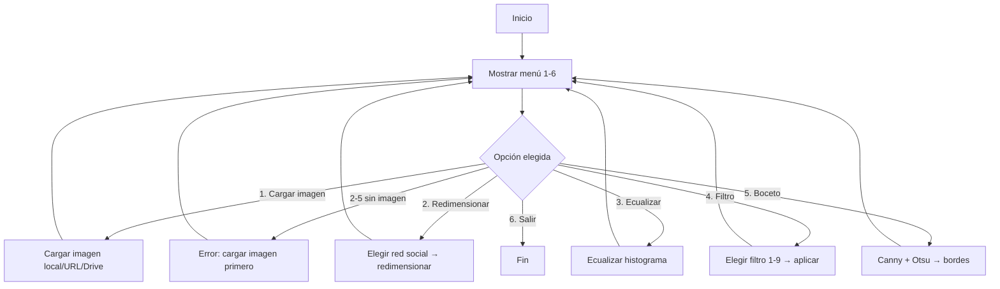

# FotoApp — Procesamiento de imágenes

**Integrantes:**
- Marcelo Palma
- Alberto Ramiro

**Materia:** Programación Python Avanzada
**Año:** 2026

## Descripción
Permite cargar una imagen y aplicarle redimensionado para redes sociales, ecualización de histograma, 9 filtros de Pillow y detección de bordes (Canny + Otsu).

## Requisitos
- Python 3
- Librerías: `pillow`, `opencv-python`, `numpy`, `matplotlib`, `requests`
- Instalación: `pip install pillow opencv-python numpy matplotlib requests`

## Estructura del proyecto
FotoApp/
├── fotoapp.py
├── fotoapp_testdev.ipynb
├── README.md
├── imagenes_prueba/
└── fotos_mejoradas/

## Uso
1. Ejecutar `python fotoapp.py` o desde el notebook: `fotoapp.main()`.
2. Elegir opción 1 para cargar una imagen: ruta local.
3. Aplicar las operaciones desde el menú.

## Diagrama de flujo del menú

