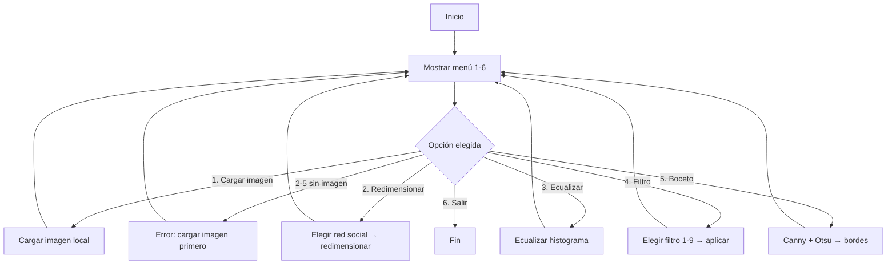

# 📷 FotoApp — Procesamiento de imágenes

> Proyecto 2 (1ra parte) — Programación Python Avanzada · 2026

## 👥 Integrantes
- Marcelo Palma
- Alberto Ramiro

## 📝 Descripción
Aplicación en Python para editar fotos: carga una imagen y permite redimensionarla para redes sociales, ecualizar el contraste por histograma, aplicar 9 filtros de Pillow y generar un boceto por detección de bordes (Canny + Otsu).

## 🛠️ Requisitos
- Python 3
- Librerías: `pillow`, `opencv-python`, `numpy`, `matplotlib`

Instalación:
```bash
pip install pillow opencv-python numpy matplotlib
```

## 📂 Estructura del proyecto
```
FotoApp/
├── fotoapp.py                 # módulo con las funciones y el menú
├── fotoapp_testdev.ipynb      # pruebas de las funciones
├── README.md
├── imagenes_prueba/           # fotos de prueba
│   └── foto1.jpg
└── fotos_mejoradas/           # imágenes generadas
    ├── redimensionada_Instagram.jpg
    ├── prueba_oscura.png
    ├── prueba_clara.png
    ├── filtro_*.png
    └── boceto.png
```

## ▶️ Uso
1. Ejecutar `python fotoapp.py` o desde el notebook: `fotoapp.main()`.
2. Elegir opción **1** para cargar una imagen (ruta local).
3. Aplicar las operaciones desde el menú (opciones 2-5).

## 🔧 Funciones
| Función | Descripción |
|---|---|
| `redimensionar(ruta, red)` | Redimensiona sin distorsión para Youtube/Instagram/Twitter/Facebook (`ImageOps.contain`). |
| `ecualizar(imagen, nombre)` | Ecualización de histograma (original vs. ecualizada). |
| `aplicar_filtro(imagen, nombre_filtro)` | Aplica uno de los 9 filtros de Pillow. |
| `hacer_boceto(imagen_pil)` | Boceto por bordes (Canny + umbralización Otsu). |

## 🔗 Repositorio
https://github.com/MarceloAdan73/FotoApp

## 📊 Diagrama de flujo del menú


